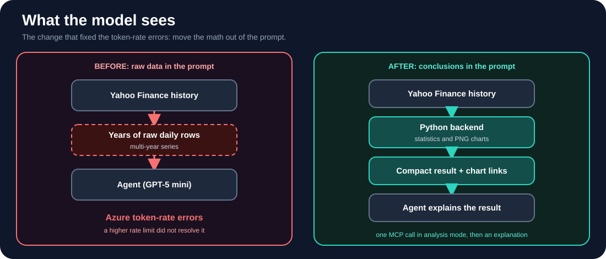
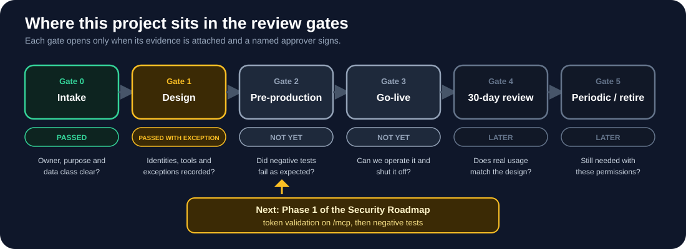

# Security Review Guide for AI Agents

*Principles, review gates and a consolidated checklist, drawn from building Stock Trend Intelligence.*

## Purpose and scope

This guide helps a product or program manager run a security review of an AI agent without needing to write the code. It combines seven principles, each backed by something that happened in this project, with a gate model and a single checklist at the end.

It is a practical framework, not a Microsoft requirement or a compliance standard. Adapt it to your organization's policies. The technical implementation steps are in the [Security Roadmap](SECURITY_ROADMAP.md).

## Part 1: Seven principles

### 1. Provide the model with conclusions, not raw data

**Observed in this project:** passing multi-year price series to the agent produced Azure token-rate errors, and raising the deployment rate limit did not resolve it. Calculations and chart generation moved into Python, and the agent now receives a compact result with chart links.

**Review question:** what is the largest volume of data the model receives in a single call? Smaller inputs reduce cost, latency and the amount of content that can be manipulated or exposed.



### 2. Limit each agent to a small set of read-only tools

**Observed in this project:** the Foundry playground failed because required tool approvals were not supplied. Approvals were not disabled. The agent was restricted to one tool, `get_stock_history`, and only that tool was auto-approved.

**Review question:** can each tool modify or delete anything? Every tool should have a recorded access type and approval mode. Read-only tools may be auto-approved; write-capable tools should require explicit approval.

### 3. Minimize the number of secrets

**Observed in this project:** the Alpha Vantage integration required a provider API key and was not completed. The project uses Yahoo Finance data through yfinance, so the only secret is the Telegram bot token, held in the hosting environment and never committed. The trade-off is documented: the data source is unofficial and intended for personal or research use.

**Review question:** how many secrets exist, who owns each one, how are they rotated, and what was traded away to avoid the others?

### 4. Use a model only where a model is needed

**Observed in this project:** the Telegram path never calls a language model. It parses the ticker, runs the Python analysis and returns the charts. That path consumes no Azure inference tokens and has no prompt to manipulate.

**Review question:** which requests actually require a model? Deterministic paths are cheaper to run and easier to secure.

### 5. Evaluate cost at idle, not only per call

**Observed in this project:** a Qwen3.5-4B managed-compute option was quoted at about $3.95 per hour including idle time and was not deployed. GPT-4o mini was marked deprecated, and the GPT-4o mini and GPT-5 nano deployments lacked quota in this project.

**Review question:** what does the system cost while idle, and where are the budget alert and the shutdown procedure?

### 6. Document what the system will not do

**Observed in this project:** one-week correlation returns N/A because five daily returns are below the ten-pair minimum. Chart links expire after one hour, and runtime state resets on restart. These limits are stated in the README.

**Review question:** which outputs does the system intentionally withhold, and are those limits written where users will see them? Clear limits reduce over-reliance on the output.

### 7. Separate what is built from what is planned

**Observed in this project:** SMS messaging through Twilio was evaluated but nothing was created: no account, number, registration or billing. The project notes record this explicitly, and the Security Roadmap marks each control as done or a gap.

**Review question:** is every item labelled as done, planned or only discussed? Ambiguous status is how unimplemented controls get approved.

### Anticipated risk (not yet experienced)

This item is derived from Microsoft's Foundry documentation and has not been observed in this project. Publishing an agent as an Agent Application switches its tool calls from the project identity to a new application identity, and existing permissions do not carry over. After the first publish, the MCP role assignment must be verified on the new identity before the release is announced.

## Part 2: Review gates

A gate passes only when the named approver signs it. Exceptions are recorded with an owner and an expiry date.

| Gate | Decision to be made | Required evidence | Approver |
|---|---|---|---|
| 0 Intake | Is the purpose, owner and data class clear? | Agent card, data classification | Sponsor |
| 1 Design | Does every hop have a named identity and a bounded tool set? | Architecture diagram, permissions matrix, tool inventory | Security reviewer |
| 2 Pre-production | Do the controls hold when tested adversarially? | Positive and negative test results, secret scan, log sample | Engineering lead and security reviewer |
| 3 Go-live | Can the agent be operated and shut off? | Runbook, tested shutdown, named on-call, alert routing | Operations and sponsor |
| 4 Post-launch (30 days) | Does real usage match the design? | Log review, cost comparison, role review | PM |
| 5 Periodic and retirement | Should this agent still exist with these permissions? | Quarterly recertification, retirement record | Sponsor |

**Current status of this project:** Gate 0 passed. Gate 1 passes with one recorded exception: the public, unauthenticated `/mcp` endpoint, accepted for a read-only pilot using public data. Gates 2 and 3 are not yet met. The next work item is Phase 1 of the roadmap: token validation on `/mcp` with negative tests.



## Part 3: Consolidated checklist

Use this list for every review. A gate is open only when all of its items are checked or have an approved, dated exception.

### Gate 0: Intake

- [ ] Named owner and sponsor recorded on the agent card
- [ ] Purpose and intended users documented
- [ ] Data classified (public, internal, confidential or regulated)
- [ ] Data sources and their licence terms identified
- [ ] Intended tools listed, each marked read-only or write-capable
- [ ] Cross-boundary data flows identified, including calls to non-Microsoft services

### Gate 1: Design

- [ ] Architecture and data-flow diagram reviewed
- [ ] Largest model input per call identified, and raw data kept out of the prompt where possible
- [ ] Paths that do not need a model identified and kept deterministic
- [ ] Identity and permissions matrix completed: identity, resource, role, scope, reason, approver, review date
- [ ] Authentication method chosen for each tool connection
- [ ] Each agent has its own identity with least-privilege roles
- [ ] Unauthenticated endpoints recorded as accepted risks with an owner and expiry date
- [ ] Approval mode set explicitly for every tool
- [ ] Secrets inventoried with an owner and a rotation method for each
- [ ] Threat and risk register started, with an owner for every top risk
- [ ] Preview features listed, each with a fallback and a review date
- [ ] Roadmap items labelled done, planned or discussed only

### Gate 2: Pre-production

- [ ] Positive test passed: the authorized agent can call the tool
- [ ] Negative tests passed: no token, wrong audience, wrong tenant and missing role are all rejected
- [ ] Token validation checks signature, audience, issuer, tenant and role
- [ ] Secret scan of the repository and its full history completed and recorded
- [ ] Guardrail and content-filter settings reviewed
- [ ] Rate limits configured and tested
- [ ] Logging and tracing enabled, and a test event located in the logs
- [ ] Budget, cost alert and shutdown procedure defined
- [ ] Known limits and intentionally withheld outputs documented for users

### Gate 3: Go-live

- [ ] Permissions re-verified on the published application's identity after publishing
- [ ] Callers hold only the role they need, for example Foundry User on the application
- [ ] Runbook written and rollback tested once
- [ ] Shutdown or kill switch tested
- [ ] Alerts routed to a named on-call person
- [ ] Hosting suited to the trust boundary, including restart behavior and state loss
- [ ] Open exceptions closed or re-approved with new expiry dates
- [ ] Support and incident contacts published

### Gate 4: Post-launch review (30 days)

- [ ] Sign-in, audit and trace logs reviewed for unexpected callers or roles
- [ ] Actual cost compared with the budget
- [ ] Denied requests and guardrail hits reviewed
- [ ] Every role assignment re-confirmed as still needed
- [ ] Risk register updated with findings

### Gate 5: Periodic review and retirement

- [ ] Quarterly: owners, sponsors and role assignments recertified
- [ ] Each release: negative tests and post-publish permission check repeated
- [ ] After any Foundry change affecting identity or publishing: documentation and roadmap re-read
- [ ] Retirement: agent disabled, role assignments removed, tokens revoked, unused resources deleted, evidence archived

### Sign-off record

```text
Agent:           ____________________
Gate:            ____________________
Date:            ____________________
Evidence pack:   ____________________ (link)
Result:          PASS / PASS WITH EXCEPTIONS / BLOCKED
Exceptions:      ID | description | owner | expiry date
Approver(s):     ____________________
Next review:     ____________________
```
