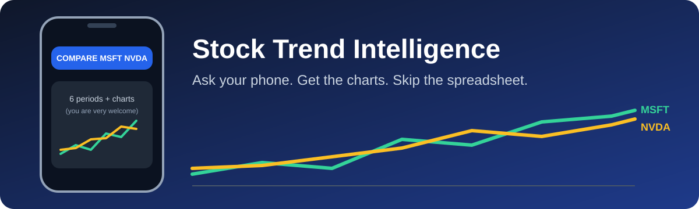
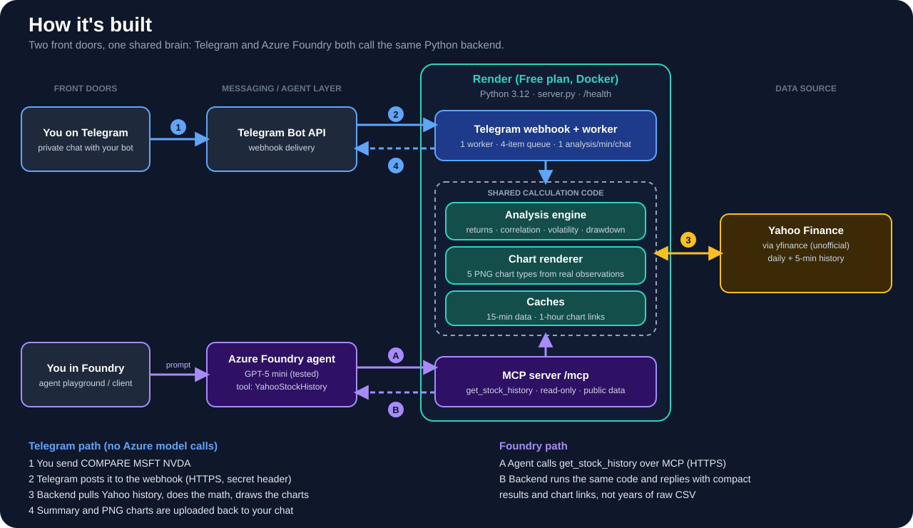
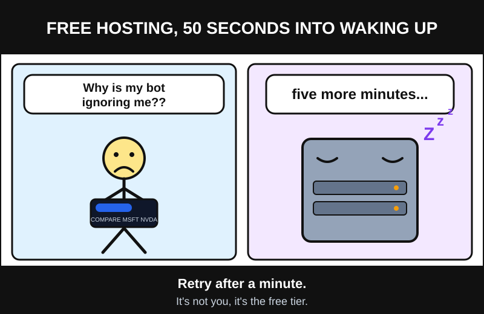
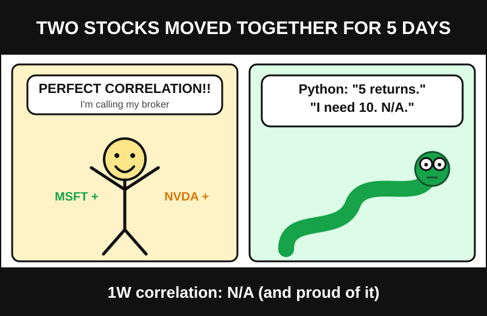
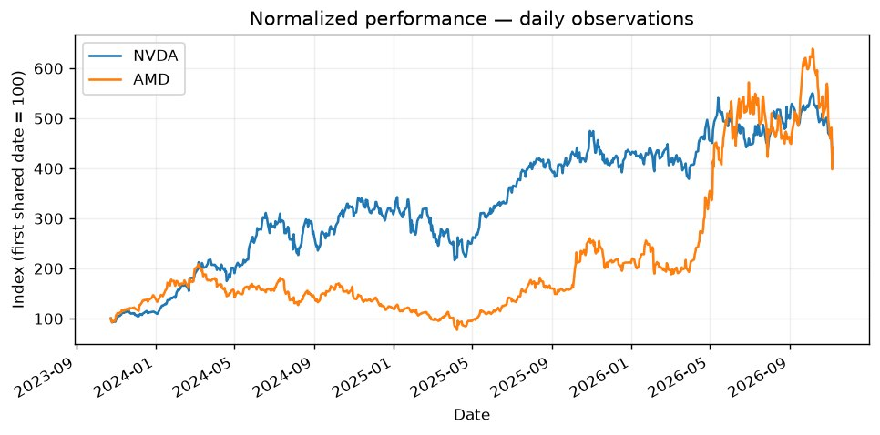
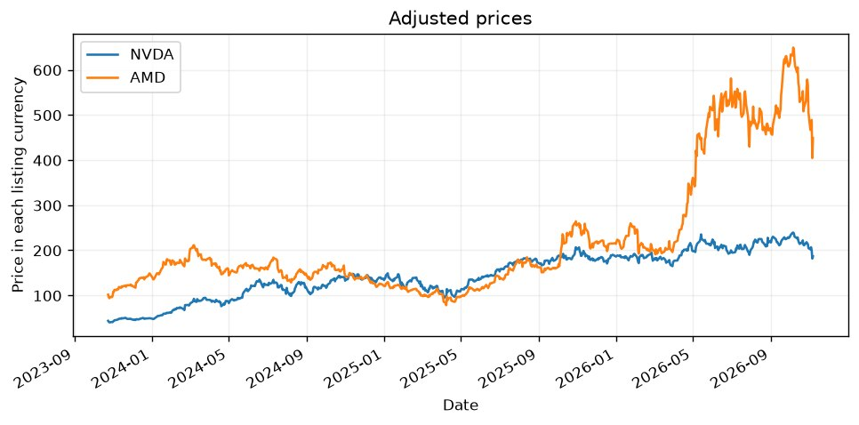
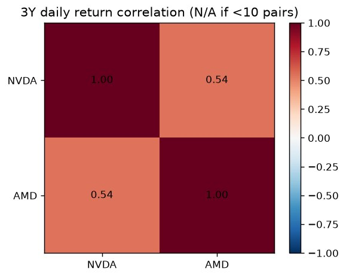
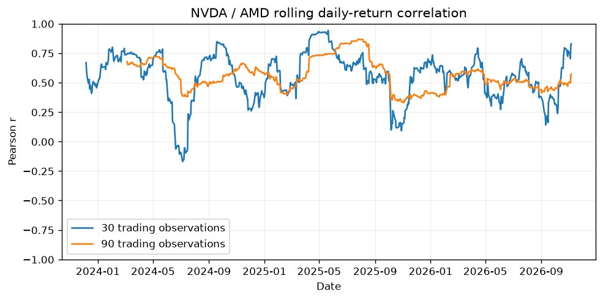
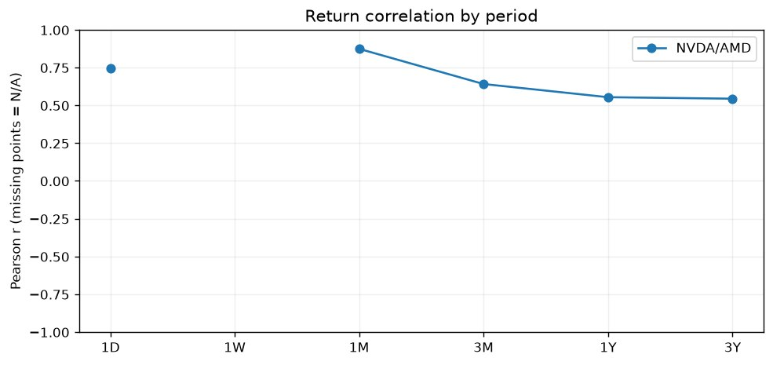

# Stock Trend Intelligence: Azure Foundry + Telegram



> **TL;DR:** A Telegram bot and an Azure Foundry agent, both backed by one Python service that pulls Yahoo Finance history through yfinance, does the math, and draws the charts. Hosted on Render's free plan. No market-data API key required.
>
> Jump to: [Try the bot](#chapter-1-ask-a-question) · [A real run](#a-real-run-nvidia-vs-amd) · [Connect Foundry](#chapter-3-let-an-agent-do-the-asking) · [Run your own copy](#chapter-4-run-your-own-copy)

### The stack at a glance

| Layer | What it uses |
|---|---|
| Data | Yahoo Finance via yfinance (unofficial, personal/research use) |
| Backend | Python 3.12, a single server.py (calculations, charts, MCP server, Telegram webhook), packaged with Docker |
| Hosting | Render, Free plan |
| Chat interface | Telegram Bot API (webhook, private chats only) |
| Agent interface | Microsoft Foundry agent calling the backend as an MCP tool (GPT-5 mini in the tested setup) |
| Output | Summary tables plus five server-rendered PNG chart types |



*Are NVIDIA and Microsoft moving together, or quietly drifting apart?*

I wanted to answer questions like that without opening a terminal, signing up for a market-data service, or squinting at a spreadsheet. So I built something I could ask from my phone.

Open Telegram, send `COMPARE MSFT NVDA`, and a few seconds later you get six time periods of returns, correlation scores, and the charts that show the story behind the numbers. Ask an Azure Foundry agent the same question in plain language and it answers from the very same code.

It's a working personal pilot: real Yahoo Finance history, Python doing the math, five chart types, a Microsoft Foundry agent, and a Telegram bot. No market-data provider API key required.

## Chapter 1: Ask a question

Open your bot in Telegram using its configured username, tap **Start**, then send any of these:

```text
MSFT
NVIDIA
COMPARE MSFT NVDA
/compare AAPL AMZN GOOGL
```

The bot accepts one to five tickers, comma-separated or space-separated, plus a small set of company aliases. It replies with six-period returns, paired return correlations, and chart images. It uses the Python backend directly, without Azure model calls. It supports private chats only and limits each chat to one analysis per minute.

A few honest expectations before you try it:

- You get the **latest completed trading session**, not a streaming or guaranteed real-time quote.
- Free hosting can take 50 seconds or more to wake up. If your first message disappears during a restart, wait a minute and send it again.

And yes, that wake-up wait is as dramatic as it sounds:



## Chapter 2: What happens behind the scenes

Both interfaces, Telegram and Foundry, share the same calculation code. Here is the journey of a single question:

1. The backend fetches prices from Yahoo Finance.
2. Python computes the statistics and renders PNG charts from the real observations.
3. Telegram receives a summary and the uploaded chart images. Foundry receives compact results and chart URLs instead of years of raw CSV data, which keeps the agent fast and cheap.

### What you get back

| Feature | Behavior |
|---|---|
| Default periods | 1D, 1W, 1M, 3M, 1Y, 3Y |
| Performance | Start/end values and dates, absolute/percentage change, highs/lows, average volume, volatility, maximum drawdown, observation count |
| Price basis | Provider adjusted close when available consistently; otherwise disclosed price returns |
| Daily correlation | Pearson correlation of aligned daily simple returns; missing values are excluded, never filled with zero |
| 1D performance | Change between consecutive completed daily closes |
| 1D correlation | Synchronized 5-minute US regular-session returns; unavailable for unsupported exchanges or insufficient data |
| Minimum correlation sample | 10 paired returns with nonzero variance; otherwise N/A |
| Volatility | Sample standard deviation of log returns, annualized by square root of 252 |
| Rolling correlations | 30 and 90 observation windows for the first selected pair |
| Multiple stocks | All pairwise correlation scores; full 3Y heatmap |
| Missing history | Period marked unavailable if a valid starting baseline is absent |

A one-week daily window normally has only five returns, so 1W correlation is N/A. That is intentional: I would rather show nothing than a number that means nothing.



### The charts

Five PNGs tell the story from different angles: normalized performance, price history, correlation heatmap, rolling correlation, and correlation by period. A single-stock request produces the two applicable price charts. Charts use actual retrieved observations; they are not synthetic demonstrations or downsampled model reconstructions.

## A real run: NVIDIA vs AMD

Theory is nice. Here is what the bot actually returned on **2026-11-06** (latest completed session) when I asked it to compare NVDA and AMD.

| Stock | 1D | 1W | 1M | 3M | 1Y | 3Y |
|---|---|---|---|---|---|---|
| NVDA | +2.78% | -8.80% | -21.99% | -14.68% | -0.53% | +309.17% |
| AMD | +11.04% | -11.05% | -30.86% | -8.22% | +88.91% | +301.83% |

| Pair | 1D | 1W | 1M | 3M | 1Y | 3Y |
|---|---|---|---|---|---|---|
| NVDA/AMD correlation | 0.74 (n=77) | N/A (n=5) | 0.87 (n=23) | 0.64 (n=65) | 0.55 (n=251) | 0.54 (n=753) |

The plot twist: over three years the two are nearly neck and neck (+309% vs +302%), but they took very different roads. AMD drifted sideways, even slipping back near its starting level in early 2025, then surged in 2026, which is why its 1Y return is +89% while NVDA's is about flat. Both have had a rough month, and the 1M correlation of 0.87 says they fell together.



The adjusted prices show the same story in raw dollars:



Over three years the daily-return correlation is a moderate 0.54:



But it is not constant. The rolling view shows it dipping close to zero in mid-2024 and again in late 2025, then climbing back:



And by period, the correlation grows as the window shrinks, with the 1W gap left blank on purpose (only 5 returns):



*These are descriptive statistics from one session, not a forecast.*

## Chapter 3: Let an agent do the asking

The same backend also speaks MCP, so a Microsoft Foundry agent can call it as a tool.

1. Add **Custom → Model Context Protocol** under the agent's tools.
2. Name the connection `YahooStockHistory`, use your deployed HTTPS `/mcp` URL, and choose **Unauthenticated** authentication.
3. Restrict allowed tools to `get_stock_history`.
4. For this read-only public-data tool, configure **Always auto-approve specific tools** with `get_stock_history`. The playground previously failed when required approvals were not supplied.
5. Use [agent_addendum.txt](agent_addendum.txt) as the agent instructions, then **Apply** and **Save**.

Code Interpreter and web search were removed from the agent because the backend now performs calculations and generates charts. The call is compact:

```python
get_stock_history(symbol="MSFT,NVDA", analysis=True)
```

For raw data, use one verified ticker with explicit inclusive start and exclusive end:

```python
get_stock_history(symbol="MSFT", start="2026-10-01", end="2026-11-07", interval="1d", analysis=False)
```

Raw mode supports up to four years of daily history or recent intraday history (59-day request bound, intervals 5m/15m/60m). Provider availability can be more restrictive. Compact analysis always covers the six default periods; it is not yet an arbitrary custom-start analysis API.

Try this prompt:

> Compare MSFT and NVDA across all six periods. Call get_stock_history with symbol="MSFT,NVDA" and analysis=true. Show performance and return-correlation tables, sample counts, and the returned chart links.

Foundry clients may display external image Markdown as text rather than inline images. Click the returned chart links when that happens. Telegram uploads the actual images directly.

## Chapter 4: Run your own copy

This repository contains reusable deployment instructions. Configure the actual bot username, hosting address, cloud project and resource names in your own environment.

| Component | Configuration |
|---|---|
| Telegram bot | Your bot username, created through BotFather |
| Backend | Your HTTPS host; Docker deployment supported |
| Health and bot status | https://YOUR_HOST/health |
| Foundry tool | YahooStockHistory at https://YOUR_HOST/mcp |
| Foundry project, resource and agent | Select your own Azure project, resource and agent |
| Language model | A model available under your project's quota; the tested integration used GPT-5 mini |
| Secrets | Store the Telegram token in the hosting environment, never in this repository |

See [validation](VALIDATION.md) for checks completed. Runtime counters reset on restart and are not durable usage records.

### Locally (Python 3.12)

```bash
python -m venv .venv
. .venv/bin/activate
python -m pip install -r requirements.txt
python -m unittest -v
python server.py
```

Local MCP: `http://localhost:8000/mcp`. Foundry needs a publicly reachable HTTPS endpoint; it cannot call your localhost.

### On Render

Connect this repository to a Docker Web Service, choose the Free compute plan, leave root directory empty, and set health check `/health`. The Dockerfile runs `python server.py`. Render supplies `PORT` and `RENDER_EXTERNAL_HOSTNAME`; deployments follow commits to `main`. A documentation commit may also trigger a redeploy.

| Environment variable | Purpose |
|---|---|
| TELEGRAM_BOT_TOKEN | BotFather token; set privately in Render, never commit or paste into logs |
| TELEGRAM_ALLOWED_CHAT_IDS | Optional comma-separated numeric chat IDs to restrict the bot |
| PORT | HTTP listening port; supplied by Render |
| RENDER_EXTERNAL_HOSTNAME | Public hostname; supplied by Render |
| PUBLIC_HOST | Public hostname without scheme/path when using another host |

On startup, the app calls Telegram `getMe` and registers `https://HOST/telegram/webhook` using `setWebhook` with a derived secret header. Do not use another bot process that overwrites the same webhook. No Azure credentials are needed for Telegram mode.

## Chapter 5: The fine print (what this is and isn't)

This is a personal pilot, not a product. Being clear about its edges is part of the story.

**What it will never do:** place orders, access accounts, or give personalized investment recommendations. Historical returns and correlation do not predict future performance or establish causation.

**Security:**

- `/health` exposes only service state, bot username, registration state and aggregate counters, never the bot token, chat IDs or message text.
- Webhook requests require the Telegram secret header. The app replies only to incoming private chats and never proactively contacts people.
- The MCP endpoint is public and unauthenticated and accepts only bounded public-market-data requests. It has no trading or account-access features.

**Limits to know about:**

- Caches: 15-minute provider buckets (up to 64 results); chart cache of up to 16 analyses, served for one hour or until restart/eviction. Rerun the analysis to regenerate expired chart links. Delivered Telegram photo uploads remain in Telegram.
- Telegram uses one worker and a four-item in-memory queue. Update IDs are deduplicated for up to 24 hours, capped at 1,000 entries. Queue, throttle and deduplication state are not durable across restarts, so message delivery is not guaranteed.
- Yahoo data is unofficial through yfinance, subject to Yahoo terms, and intended here for personal/research use. Rate limits, cloud-host blocks, missing values and revisions are possible.
- Different currencies are not converted. Intraday regular-session filtering currently covers supported US listings. Corporate actions and adjustment conventions affect interpretation.

## Epilogue: What it costs, and how to say goodbye

The Render service is configured on the Free plan. Normal Telegram Bot API testing has no per-message SMS fee, and the current Telegram path makes no Azure model calls. Foundry interactions remain subject to Azure model usage charges, and earlier Code Interpreter and web-search testing may also have incurred charges. No actual billing total was audited here. The [project notes](PROJECT_NOTES.md) explain the rate-limit optimization, model choices, and why SMS was discussed but not implemented.

To check Azure spend, open **Cost Management → Cost analysis**, select the relevant subscription, filter to your deployment resource group, and group by Resource. Cost reporting can lag. Render billing is separate.

**Retiring the pilot:** remove the Render service and review Render billing. To retire Telegram completely, delete the bot through BotFather (or revoke its token and remove the webhook if retaining it for reuse), and remove the token from Render. Review Azure costs separately and delete only the deployments and resources you intend to retire.

## A map of the repository

| File | Purpose |
|---|---|
| [server.py](server.py) | Data retrieval, calculations, charts, MCP, Telegram webhook and worker |
| [test_server.py](test_server.py) | Nine meaningful calculation, protocol and Telegram tests |
| [requirements.txt](requirements.txt) | Python dependencies |
| [Dockerfile](Dockerfile) | Container entry point |
| [render.yaml](render.yaml) | Free-plan deployment blueprint |
| [agent_addendum.txt](agent_addendum.txt) | Compact Foundry agent instructions |
| [VALIDATION.md](VALIDATION.md) | Checks completed and remaining limits |
| [PROJECT_NOTES.md](PROJECT_NOTES.md) | Decisions and implemented vs. discussed scope |

## Official references

- [yfinance](https://ranaroussi.github.io/yfinance/)
- [MCP Python SDK](https://github.com/modelcontextprotocol/python-sdk/tree/v1.x)
- [Render free services](https://render.com/docs/free)
- [Telegram Bot API](https://core.telegram.org/bots/api)
- [Foundry Code Interpreter](https://learn.microsoft.com/azure/foundry/agents/how-to/tools/code-interpreter)
