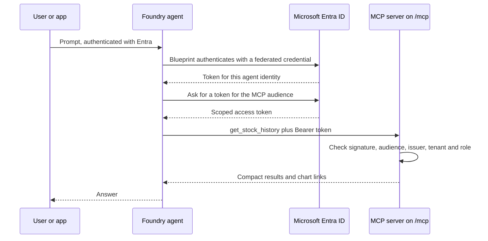
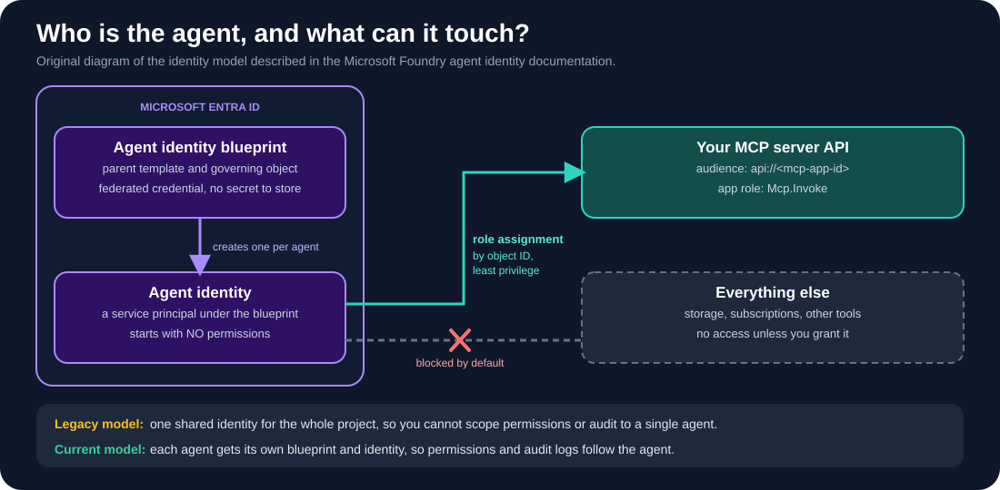
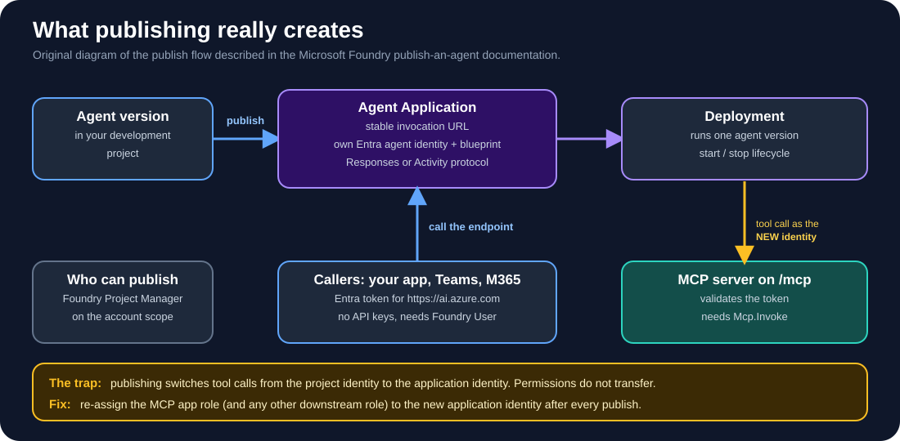

# Security Roadmap for Agents

*How this project grows from a friendly personal pilot into an agent you could trust with a real identity.*

Every agent project starts the same way: it works, it is a little magical, and nobody asks who is allowed to call it. This one began that way too. Today the Foundry agent talks to a public, unauthenticated, read-only `/mcp` endpoint. That is a reasonable trade for a pilot that only serves public market data and has no trading or account features. It is not where we want to end up.

This roadmap uses **Stock Trend Intelligence** as the worked example for a bigger question: *how do you give an Azure Foundry agent a real identity, publish it, and lock down everything it touches?* It is a plan, not a description of what is already built. Each phase says what changes, why, and how you would check it worked.

> Foundry's agent identity and publishing features are partly in preview and the docs move quickly. Treat the commands and role names below as a starting point and confirm them against the linked Microsoft pages before you rely on them. Role names also changed recently: **Azure AI User** is now **Foundry User**, with the same permissions.

## Where we are today

| Area | Current state | Status |
|---|---|---|
| Secrets | Telegram token lives only in the hosting environment, never in the repo | Done |
| Telegram webhook | Requires a derived secret header; replies only to private chats | Done |
| Chat allow-list | Optional `TELEGRAM_ALLOWED_CHAT_IDS` restricts who can use the bot | Done |
| Abuse limits | One analysis per minute per chat, bounded queue, bounded MCP requests | Done |
| Tool scope | Single read-only tool, `get_stock_history`, public data only | Done |
| MCP endpoint | Public and unauthenticated; Foundry connection uses *Unauthenticated* | **Gap** |
| Agent identity | Not designed yet; no per-agent permissions | **Gap** |
| Publishing | Agent is used from the playground, not published as its own endpoint | **Gap** |
| Monitoring | Aggregate counters on `/health` only | **Gap** |

## The big picture

The goal is that every hop has a named identity and every identity has the smallest permission that works.



## Phase 1: Close the front door on /mcp

**Why first:** it is the only part of the system that anyone on the internet can call today.

1. **Register the MCP server as an API in Microsoft Entra.** Give it an Application ID URI such as `api://<mcp-app-id>`. That value is the *audience* tokens must be issued for.
2. **Define an app role**, for example `Mcp.Invoke`, with `allowedMemberTypes` set to `Application`.
3. **Validate every request in `server.py`.** Reject anything that fails signature, `aud`, `iss`, `tid` or role checks. A sketch (general Entra guidance, not copied from a Foundry sample):

```python
import jwt
from jwt import PyJWKClient

TENANT_ID = "<tenant-id>"
AUDIENCE = "api://<mcp-app-id>"          # must match the Foundry connection audience
ISSUER = f"https://login.microsoftonline.com/{TENANT_ID}/v2.0"
JWKS = PyJWKClient(f"https://login.microsoftonline.com/{TENANT_ID}/discovery/v2.0/keys")
REQUIRED_ROLE = "Mcp.Invoke"

def validate(auth_header: str) -> dict:
    token = auth_header.removeprefix("Bearer ").strip()
    key = JWKS.get_signing_key_from_jwt(token).key
    claims = jwt.decode(token, key, algorithms=["RS256"], audience=AUDIENCE, issuer=ISSUER)
    if claims.get("tid") != TENANT_ID:
        raise PermissionError("wrong tenant")
    if REQUIRED_ROLE not in claims.get("roles", []):
        raise PermissionError("missing role")
    return claims
```

   Decode a real test token before you finalize the role check, to confirm whether your token carries `roles` (app-only) or `scp` (delegated).
4. **Switch the Foundry connection** from *Unauthenticated* to agent identity:

```bash
azd ai project set "https://<account>.services.ai.azure.com/api/projects/<project>"
azd ai connection create yahoo-stock-history \
  --kind remote-tool \
  --target https://<your-host>/mcp \
  --auth-type agentic-identity \
  --audience "api://<mcp-app-id>"
```

5. **Assign the `Mcp.Invoke` role** to the agent identity's service principal (Enterprise applications, or the Graph `appRoleAssignments` API).

**How you know it worked:** a normal tool call succeeds, and the same call with a missing role, wrong audience or no token is rejected with 401 or 403.

Never forward a Microsoft-audience token to your own server. Your server owns its audience.

## Phase 2: Give the agent its own identity

Foundry can create a dedicated **agent identity** in Microsoft Entra for each agent. It is a service principal under an **agent identity blueprint**, and the blueprint holds a federated credential that trusts the Azure Machine Learning resource provider, so there is no client secret to store or leak.



*An original diagram of the model. Microsoft's own explanation and diagrams are in the [agent identity documentation](https://learn.microsoft.com/en-us/azure/foundry/agents/concepts/agent-identity).*

What matters for this project:

- **Each agent gets its own identity in the current model.** The older model shared one identity across the whole project, which meant you could not scope permissions or audit to a single agent.
- **A new agent identity starts with no permissions.** Foundry does not assign roles for you. Grant only what the agent needs: here, the single app role on the MCP API, and nothing on storage, subscriptions or other resources.
- **Assign by object ID,** at the narrowest scope that works (resource or resource group, never the subscription by default).
- **Authentication is not authorization.** Getting a token for an audience does not grant access; the downstream service's own role checks still decide.
- **Govern it like a person.** In the Microsoft Entra admin center, agent identities appear in the tenant inventory. Set owners, sponsors and expiration, and consider Conditional Access and Identity Protection where supported.

**How you know it worked:** the Entra inventory lists the agent identity, it has exactly one role assignment, and removing that assignment makes tool calls fail.

## Phase 3: Publish the agent

Publishing turns a development agent into a managed Azure resource with a stable endpoint.



*An original diagram of the flow. See Microsoft's [publish an agent](https://learn.microsoft.com/en-us/azure/foundry/agents/how-to/publish-agent) article for the official steps and screenshots.*

- **What it creates:** an *Agent Application* with its own invocation URL, authentication policy, and a distinct Entra agent identity and blueprint, plus a *deployment* pointing at a specific agent version.
- **Who can do what:** publishing needs **Foundry Project Manager** on the Foundry resource (account) scope. Calling the published endpoint needs **Foundry User** on the application scope. **Foundry Agent Consumer** does *not* grant access to Agent Applications.
- **How callers authenticate:** with Microsoft Entra ID tokens for `https://ai.azure.com`. API keys are not supported. Never paste access tokens into code.
- **Channels:** the Responses protocol for your own apps; the Activity protocol for Microsoft 365 and Teams. Only one protocol per application at a time.
- **The trap:** publishing **changes which identity the agent uses for tool calls**. Permissions do *not* carry over. After you publish, repeat the Phase 1 role assignment for the new application identity, or tool calls will fail with authorization errors.
- **Limits to plan around:** published endpoints are stateless (clients resend conversation history), and each application routes traffic to one active deployment.

A note on "publishing to Entra ID": Foundry creates and manages the Entra agent identity for you, and it shows up in the Entra admin center inventory. The publishing documentation says Foundry Agent Applications are **not** registered in the Microsoft Entra *agent registry*, so do not assume publishing adds the agent there. Check the current Entra documentation if registry listing matters to you.

Also note that the publish article describes the *legacy* publishing experience and points to a migration guide for the newer agent endpoint model. Start from the migration guide for anything new.

**How you know it worked:** a client with Foundry User can call the endpoint, a client without it gets 403, and the end-to-end tool call still succeeds under the new identity.

## Phase 4: Guardrails and runtime protection

Identity answers *who*; guardrails answer *what is being asked and returned*.

- **Guardrail policies** in the Foundry portal (Operate, then Compliance, then Policies) can require minimum content filters, prompt shields and abuse detection across a subscription or resource group.
- **Defender for Cloud** surfaces posture issues and can alert on jailbreak and prompt-injection attempts against Foundry endpoints.
- **Purview** can capture AI interaction data for audit and classification. It needs a Purview license, only enforces data-security policies for Entra user-context calls, and does not yet support network isolation.
- **Tool approvals:** be explicit. `require_approval` defaults to *always*. Today this project auto-approves the one read-only tool; keep it that way only because the tool is read-only, and keep any future write-capable tool on *always*.
- **Toolbox guardrails and Azure API Management** can screen tool inputs and outputs and add rate limiting, logging and network policy in front of the MCP server.

## Phase 5: Harden the hosting

The free Render plan is perfect for a pilot and wrong for a trust boundary: it sleeps, restarts clear in-memory state, and the endpoint is publicly reachable.

- Move the MCP server to a host where you can enforce authentication and network rules, such as **Azure Container Apps** (with your own token validation) or **Azure Functions** (built-in authentication).
- Use **internal-only ingress** if Foundry and the server can share a private network.
- Put **API Management** in front for throttling and audit.
- Replace the in-memory throttle and de-duplication with a durable store so limits survive restarts.

## Phase 6: Keep the Telegram path honest

The Telegram bot makes no Azure model calls, but it is still an entry point.

- Keep the webhook secret header and private-chat-only behavior.
- Turn the optional chat allow-list into a default for anything beyond personal use.
- Rotate the bot token if it ever appears in a log, and revoke it through BotFather when retiring the bot.
- Do not log message text. Keep `/health` limited to aggregate counters.

## Phase 7: See everything, alert on what matters

- **Entra sign-in logs:** filter by agent type to see blueprint, agent identity and agent user sign-ins.
- **Entra audit logs:** use `agentType` and `blueprintId` to tie an identity back to its blueprint.
- **Foundry tracing:** connect Application Insights and inspect tool calls per agent.
- **Alerts:** failed token validations on `/mcp`, sudden spikes in calls per identity, and role-assignment changes.
- **Cost:** review Azure Cost Management alongside security signals; a runaway agent shows up as money first.

## The checklist

| # | Control | Phase |
|---|---|---|
| 1 | MCP server registered as an Entra API with an audience and app role | 1 |
| 2 | Server validates signature, aud, iss, tid and role on every call | 1 |
| 3 | Foundry connection uses agent identity, not *Unauthenticated* | 1 |
| 4 | Negative tests: no token, wrong audience, missing role all rejected | 1 |
| 5 | Per-agent identity with least-privilege role assignments | 2 |
| 6 | Owners, sponsors and expiration set in Entra | 2 |
| 7 | Published as an Agent Application; callers hold Foundry User | 3 |
| 8 | Roles re-assigned to the published application identity | 3 |
| 9 | Guardrail policy, Defender and (optionally) Purview enabled | 4 |
| 10 | `require_approval` set explicitly per tool | 4 |
| 11 | Hosted behind authenticated, rate-limited infrastructure | 5 |
| 12 | Telegram allow-list, token rotation and no message logging | 6 |
| 13 | Sign-in, audit and trace logs reviewed, alerts configured | 7 |

## What this roadmap does not claim

It does not say the project is secure today, and it does not replace Microsoft's current documentation. Several Foundry features it relies on are in preview, so names, endpoints and API versions can change. The `server.py` snippet is a sketch to adapt and test, not a drop-in implementation.

## Sources

- [Agent identity in Microsoft Foundry](https://learn.microsoft.com/en-us/azure/foundry/agents/concepts/agent-identity)
- [Tool authentication](https://learn.microsoft.com/en-us/azure/foundry/agents/how-to/tools/tool-authentication)
- [Set up MCP server authentication](https://learn.microsoft.com/en-us/azure/foundry/agents/how-to/mcp-authentication)
- [Publish an agent](https://learn.microsoft.com/en-us/azure/foundry/agents/how-to/publish-agent)
- [Manage compliance and security in Foundry](https://learn.microsoft.com/en-us/azure/foundry/control-plane/how-to-manage-compliance-security)
- [Private tool catalog](https://learn.microsoft.com/azure/foundry/agents/how-to/private-tool-catalog)
